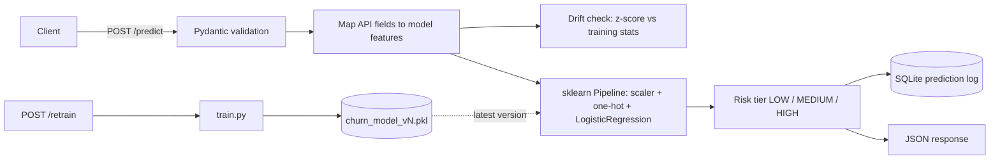

# DecisionAPI: customer churn prediction as a live API

A FastAPI service that scores how likely a telecom customer is to cancel, sorts them into LOW / MEDIUM / HIGH risk, logs every prediction, flags inputs that drift away from the training data, and can retrain and version itself through an endpoint.

**Live:** [decisionapi.onrender.com/docs](https://decisionapi.onrender.com/docs) (free Render instance, so the first request after a quiet period can take ~30 s to wake up)

---

## Results

Measured on a held-out 20 % test split (1,407 customers, stratified, `random_state=42`, the same split `train.py` uses). The model never saw these rows.

| Metric | Value |
|---|---|
| ROC-AUC | **0.833** |
| ROC-AUC, 5-fold cross-validation | 0.837 ± 0.007 |
| PR-AUC (churn is the minority class, 26.6 %) | 0.625 |
| Accuracy at 0.5 threshold | 0.800 (always predicting "no churn" scores 0.734) |
| Precision / recall for churners at 0.5 | 0.649 / 0.543 |
| Brier score (probability calibration) | 0.142 |

**The risk tiers mean something.** Actual churn rate inside each tier on the test set:

| Tier | Probability | Customers | Actually churned |
|---|---|---|---|
| LOW | < 0.30 | 816 | 9.7 % |
| MEDIUM | 0.30 – 0.60 | 406 | 43.1 % |
| HIGH | ≥ 0.60 | 185 | 64.9 % |

A retention team that only calls the HIGH tier reaches customers who leave at almost 2.5× the base rate.

**Latency.** 500 sequential `POST /predict` calls against a local uvicorn server (one worker, 20 warm-up calls discarded). Each call validates the input, runs the drift check, predicts and writes a row to SQLite.

| mean | p50 | p95 | p99 |
|---|---|---|---|
| 10.2 ms | 9.8 ms | 11.9 ms | 14.2 ms |

<sub>Reproduce: train on the same split, then score `X_test` with `app/models/artifacts/churn_model_v3.pkl`. Numbers were measured in October 2026 with scikit-learn 1.9.</sub>

---

## How it works



- **One pipeline for training and serving.** Scaling and one-hot encoding live inside a single scikit-learn `Pipeline`, so the API cannot drift from the training code.
- **Features.** 7 raw inputs (tenure, monthly charges, total charges, gender, contract, internet service, payment method) become 15 model features after encoding.
- **Model versioning.** Every `/retrain` call trains on the stored split, reports its ROC-AUC and saves `churn_model_vN.pkl`. The API loads the newest version.
- **Prediction log.** Every request is written to SQLite with its inputs, probability, tier, model version and timestamp, for audits and future retraining.
- **Drift check.** Training-set mean and standard deviation are stored for the numeric features. An input more than 3 σ away is flagged.

Dataset: [IBM Telco Customer Churn](https://www.kaggle.com/datasets/blastchar/telco-customer-churn), 7,043 customers (7,032 after dropping rows with blank `TotalCharges`).

---

## API

| Method | Path | What it does |
|---|---|---|
| GET | `/` | Health check |
| POST | `/predict` | Churn probability, risk tier, model version |
| POST | `/retrain` | Train a new version and return its ROC-AUC |

```bash
curl -X POST https://decisionapi.onrender.com/predict \
  -H "Content-Type: application/json" \
  -d '{
        "gender": "Male",
        "senior_citizen": 0,
        "tenure_months": 18,
        "contract_type": "Month-to-month",
        "internet_service": "Fiber optic",
        "monthly_charges": 85.5,
        "total_charges": 1539.0,
        "payment_method": "Electronic check"
      }'
```

```json
{ "churn_probability": 0.6136, "risk_level": "HIGH", "model_version": "v3" }
```

---

## Run it

```bash
git clone https://github.com/dubeykrish0307/DecisionAPI.git
cd DecisionAPI
python -m venv venv && source venv/bin/activate    # Windows: venv\Scripts\activate
pip install -r requirements.txt
uvicorn app.main:app --reload                      # http://127.0.0.1:8000/docs
```

## Project layout

```
app/
├── main.py              FastAPI app and routers
├── api/                 /predict and /retrain
├── core/database.py     SQLAlchemy model for the prediction log
├── data/                ingest → clean → feature pipeline
├── models/              train.py, registry.py, versioned artifacts/
├── monitoring/drift.py  training stats + 3-sigma check
└── schemas/             request / response models
data/raw/telco_churn.csv
```

---

## Known limitations and next steps

Things I found when I re-measured the project, kept here on purpose:

- [ ] The drift result is computed but not yet returned in the response or stored in the log.
- [ ] `registry.py` sorts versions as text, so `v10` would load before `v9`. Sort by the number instead.
- [ ] `senior_citizen` is accepted and logged but not used by the model. Add it as a feature or drop it from the request.
- [ ] Pin versions in `requirements.txt`. The saved models were trained on an older scikit-learn and print a version warning on load.
- [ ] Add tests for `/predict` and `/retrain`, and stop committing `predictions.db`.
- [ ] Compare against a gradient-boosted model and tune the decision threshold for recall.

---

**Krish Dubey**, B.Sc. Computer Science student at SRH Munich · [LinkedIn](https://www.linkedin.com/in/dubeykrish) · [GitHub](https://github.com/dubeykrish0307)
